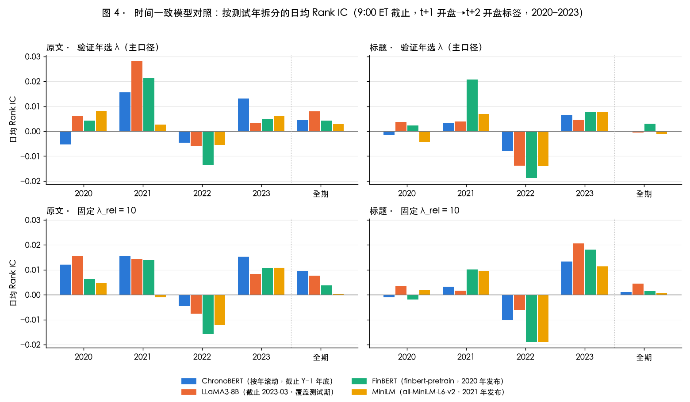

# llm-news-alpha

Replicating *Expected Returns and Large Language Models* (Chen, Kelly & Xiu) on free data: FNSPID news →
LLaMA3-8B / ChronoBERT / FinBERT / MiniLM embeddings → rolling full-dimension Ridge → next-day cross-sectional return
forecasts for S&P 500 point-in-time constituents (2015–2023, out-of-sample 2020–2023) → quintile long-short backtests
with costs, plus an incremental test against Qlib Alpha158. All computation ran on one RunPod L40S; this repository
holds the code, the `make` entry points, and the small result tables and figures under `results/`.

**Headline.** The embeddings carry strong news sentiment (same-day Rank IC 0.10–0.19), but it is realized between the
news-day close and the next open. At the first tradable point (next open) the daily Rank IC is 0.000–0.010 (best t = 1.7),
every long-short portfolio is negative after 5 bps, and no embedding model, text form, or bag-of-words baseline differs
from another beyond noise. A chronologically consistent model (ChronoBERT, rolled by year) does as well as LLaMA3-8B,
so look-ahead in the LLM is not what drives the result. Details in Chinese below.

---

复现 Chen, Kelly & Xiu《Expected Returns and Large Language Models》：LLM 新闻嵌入 → 年度滚动全维 Ridge → 次日截面收益预测 →
五分位多空回测，并在 Qlib 中与 Alpha158 做增量检验。市场为美股 S&P 500 时点成分股，新闻用免费的 FNSPID，样本期 2015–2023，
样本外 2020–2023。本文是研究报告；计划与设计理由在 `docs/plan.md`，逐日记录在 `docs/worklog.md`，数字全部来自 `results/`。

## 1. 一句话结论

嵌入里确实有新闻情绪，但它在新闻日收盘到次日开盘之间兑现；到可交易的次日开盘，信号只剩 0.000–0.010 的日均 Rank IC，
扣费后没有可交易价值。在这份数据上，嵌入模型之间、文本形式之间、LLM 与词袋法之间的差异全部在噪声内；
时间一致的 ChronoBERT 与覆盖测试期的 LLaMA3-8B 表现相当，前视偏差不是结果的来源。限制信号的是新闻时间戳的精度和来源结构，不是文本表示。

五条实证结论（第 6 节展开）：

1. 信号存在但在隔夜兑现：当天 Rank IC 0.10–0.19 → 隔夜 +0.023（t 4.3）→ 次日开盘后 0.000–0.009（t ≤ 1.7），之后无持续。
2. 模型、文本形式、词袋基线之间无显著差异：16 个 模型 × 文本 组合两两 120 对，5% 水平显著的只有 1 对。
3. 与 Alpha158 融合方向为正但不显著：LightGBM +0.003（t 1.1–1.5）；文本分数与量价分数几乎正交（秩相关 ≤ 0.006）。
4. 扣费后全部为负：等权五分位多空毛夏普 −0.6 到 +0.7，日均换手 3.5，5 bps 后净夏普 ≤ −2.1，换手控制救不回来。
5. 数据质量是主要限制：99.5% 的记录只有日期、ticker 错配、时间戳标注错误、训练期与测试期来源构成不同。

## 2. 设定：原文 vs 本项目

| 维度 | 原文 | 本项目 |
| --- | --- | --- |
| 新闻 | Refinitiv（付费），约 304 万篇美股文章，分钟级时间戳 | FNSPID（免费）：nasdaq.com 全文 + Benzinga 标题；带 ticker 的 574 万行里只有 1.4% 有时刻 |
| 股票池 | 16 个市场 | S&P 500 时点成分股（716 只，723 个成员区间），相当于原文"市值高于 NYSE 中位数"的子样本 |
| 样本期 | 1996–2019，样本外 2004–2019 | 2015–2023，样本外 2020–2023（985 个有新闻的交易日） |
| 文本 | 文章前 512 token；另比较快讯与 AI 摘要 | 标题；原文（标题 + 正文前 512 token）；LLaMA3-8B-Instruct 生成的 2–3 句摘要 |
| 文本表示 | BERT、RoBERTa、LLaMA 1/2/3、OpenAI 嵌入 | LLaMA3-8B（4096 维）；ChronoBERT 按年滚动（768 维，时间一致对照）；FinBERT、MiniLM；LM 词典、TF-IDF 为词袋基线 |
| 预测模型 | Ridge 为主 | 全维 Ridge（充分统计量，一次特征分解解整条 λ 路径）；Qlib 里另加 LightGBM、MLP |
| 滚动 | 6 年训练 + 2 年验证 | 4 年训练 + 1 年验证 + 1 年测试，λ 在验证年按日均 Rank IC 选 |
| 标签 | 次日开盘到开盘 | 同：t+1 开盘买入、t+2 开盘卖出（`Ref($open,-2)/Ref($open,-1)-1`）；收盘到收盘为稳健性 |
| 对齐 | 9:00 ET 截止 | 分层：有时刻记录 9:00 ET 截止；仅日期记录视为当日 23:59 ET，最早次日开盘交易；16:00 ET 为稳健性口径 |
| 组合 | 五分位多空，等权 / 市值加权，EWCT 换手控制 | 同；另有十分组、建仓推迟、持有 H 天、Qlib TopkDropout 多头 |
| 成本 | 10/20 bps | 0/5/10/20 bps 敏感性 + EWCT |

## 3. 数据实况

### 3.1 FNSPID 来源 × 精度 × 正文（`results/news/fnspid_parse_report.md`）

| 部分 | 行数 | 有时刻 | 有正文 | 备注 |
| --- | ---: | ---: | ---: | --- |
| 全部（`nasdaq_exteral_data.csv`） | 15,549,301 | 55.5% | 24.1% | `All_external.csv` 是它的真子集，不再使用 |
| 其中 reuters.com | 8,556,310 | 99.9% | 0% | 没有 ticker，不能用于个股预测 |
| 其中 nasdaq.com | 2,491,785 | 1.1% | 100% | 全部正文来自这里；2015–2022 时刻可用率为 0 |
| 其中 benzinga.com | 1,529,287 | 3.7% | 0% | 只有标题，止于 2020-06 |
| **带 ticker 的行** | **5,744,674** | **1.4%** | 43.4% | 可用于个股预测的部分 |

### 3.2 过滤漏斗（`results/news/embed_candidates_report.md`、`news_clean_report.md`）

| 步骤 | 剩余 | 剔除 |
| --- | ---: | ---: |
| 原始行 | 15,549,301 | |
| 日期可解析且 ≥ 2014-12-31 | 5,974,861 | 9,574,440 |
| 剔除俄语 | 5,704,408 | 270,453 |
| ticker 在 2015–2023 成分股全集 | 1,362,033 | 4,342,375 |
| 单一股票（整篇剔除，原文规则） | 511,953 | 850,080 行 / 422,914 篇 |
| 同一 news_id 去重 | 506,827 | 5,126 |
| 日期修正（见 3.3） | 504,822 | 2,005 |
| 正文长度 [100, 100,000] 字符 | 504,794 | 28 |
| 近似重复（同股票 5 个交易日内相似度 ≥ 0.8） | **477,082** | 27,712 |

news_clean：474,772 条仅日期、2,310 条有时刻（0.5%）；271,729 条有正文；股票-日覆盖率 20.6%（235,476 / 1,141,896）；
测试期 2020–2023 的原文样本 98% 来自 nasdaq.com，而训练期含大量 Benzinga 标题。

### 3.3 时间戳 / 日期校验（`results/news/tz_check_conclusions.md`）

直接抓取被 Cloudflare 拦截，改用 Wayback 快照（400 条样本，14 条解析出发布时间）加 URL 自带日期的全量比对：

| 发现 | 处理 |
| --- | --- |
| Benzinga 有时刻记录 = 真实 UTC − 8 小时（13/13 一致），数据卡的 "UTC" 标注不成立；按字面解读会把盘中新闻提前到当天开盘 | 时间戳 +8 小时后再转美东 |
| nasdaq.com 的 26,623 条"有时刻"记录全部标 2023-12-16，是抓取时间不是发布时间 | 剔除 |
| 2023-11-30 至 12-16 的 nasdaq.com 行量是正常的 10–40 倍、每篇挂 14 个 ticker：最后一次抓取按抓取期打标 | 剔除 |
| nasdaq.com URL 自带日期与 FNSPID 日期 99.1% 相同，0.9% URL 晚一天 | 日期取两者中较晚者 |
| 仅日期记录的发布时刻分布无法解析 | 一律按 23:59 ET，最早次日开盘交易 |

### 3.4 股票池、价格、市值

- 成分股：GitHub 时点成分股数据，2015-01-02 499 只、2023-12-29 503 只，716 只 / 723 个区间（`results/universe/`）。
- 价格：yfinance 552 只 + FNSPID `full_history.zip` 补 79 只；成分股区间内股票-日有价格 93.2%，缺口是 85 只两边都没有的早年退市公司（`results/prices/`）。
- 市值：SEC companyfacts 股数 × 调整后价格，处理了多类别股本、拆股按申报日换算、量级错误；90% 股票-日有市值，其余用 20 日成交额代理。

## 4. 方法与前视偏差控制

流水线：`news/` 解析与标准新闻表 → `news/build_clean.py` 日期修正、对齐、过滤 → `text/embed.py` 均值池化嵌入（float16 分片，以 news_id 为键）→
`models/aggregate.py` (特征日, ticker) 均值聚合 → `models/ridge_suffstats.py` 年度滚动 Ridge → `analysis/` 多空、DM 检验、分解；
Qlib 侧 `qlib_ext/` 把 PCA-64 新闻特征并入 Alpha158 数据集，`run_rolling.py` 跑表 B。模块之间只通过四个接口文件交互（`CLAUDE.md`）。

| 红线 | 做法 | 证据 |
| --- | --- | --- |
| 新闻时间对齐 | 有时刻记录 9:00 ET 截止；仅日期记录按当日 23:59 ET；时区校验未通过的来源降级为仅日期 | `results/news/tz_check_conclusions.md`，`tests/test_align.py` |
| 标签 | t+1 开盘买入、t+2 开盘卖出；回测 `deal_price: open` | `models/labels.py` |
| 降维与标准化 | PCA 只在 2015–2018 拟合一次；标准化只用各窗口训练期 | `results/ridge/pca_summary.md`，`qlib_ext/run_rolling.py`（RobustZScoreNorm 按窗口拟合） |
| 超参 | λ 与模型超参只在验证年选；测试年只评估一次 | `models/ridge_suffstats.py` |
| 模型语料 | ChronoBERT 测试第 Y 年只用知识截止 (Y−1)-12-31 的版本 | `results/ridge/time_consistency.md` |
| 摘要 | 温度 0、禁元句、拒答回退标题；60 条人工抽查无数字编造 | `results/ridge/text_form_comparison.md` |
| 链路 | 同一嵌入预测新闻当天收益 Rank IC 0.10–0.19，反转因子 Rank IC −0.018 | `results/baseline/baseline_sanity_checks.md`，`docs/worklog.md` |

## 5. 主结果

### 5.1 表 A：文本表示 × 文本类型（`results/ridge/table_a.md`、`dm_test.md`、`../longshort/sharpe_table*.md`）

全维年度滚动 Ridge，主口径，测试期 2020–2023 的日均 Rank IC（括号为 Newey–West t，滞后 5）与等权五分位多空毛夏普 / 净夏普 @10 bps。

| 文本表示 | 标题 Rank IC | 原文 Rank IC | 摘要 Rank IC | 原文多空 毛 / 净@10bps | 原文市值加权 毛 |
| --- | ---: | ---: | ---: | ---: | ---: |
| LLaMA3-8B | −0.0005 (−0.1) | **+0.0080 (+1.7)** | +0.0045 (+1.0) | +0.71 / −5.03 | +0.70 |
| ChronoBERT（按年滚动） | −0.0001 (−0.0) | +0.0045 (+1.1) | +0.0004 (+0.1) | +0.25 / −5.96 | +0.93 |
| FinBERT | +0.0030 (+0.7) | +0.0042 (+1.0) | +0.0049 (+1.2) | +0.25 / −5.90 | +0.59 |
| MiniLM | −0.0011 (−0.3) | +0.0028 (+0.6) | −0.0010 (−0.2) | +0.18 / −5.80 | +0.77 |
| TF-IDF（5,000 维）+ Ridge | +0.0004 (+0.1) | +0.0036 (+0.8) | – | +0.51 / −5.47 | +0.92 |
| LM 词典情绪分（无训练） | −0.0051 (−1.4) | +0.0027 (+0.7) | – | −0.05 / −5.33 | −0.14 |

- 单个组合没有一个在 5% 水平显著异于 0；两两 DM 检验 120 对里 1 对显著（LLaMA3 原文 > LM 词典标题，t 2.10），接近假阳性期望。
- "原文优于标题"是唯一在数据修正前后都成立的排序，但 t 只有 1.7。摘要 − 原文的 t 在 −0.9 到 +0.2 之间，没有增量（`text_form_comparison.md`）。
- 有时刻子集只有 2,310 条，不足以单列一栏；原计划的"全样本 / 有时刻 / 仅日期"三栏退化为全样本一栏。

### 5.2 表 B：Alpha158、新闻、融合 × Ridge、LightGBM、MLP（`results/qlib/table_b.md`、`incremental.md`）

Qlib 数据集 `us_sp500_news_fnspid`：成分股全部股票-日（无新闻日新闻特征为 0，has_news 入特征），新闻特征 = LLaMA3 PCA-64 + news_cnt + has_news。
滚动 4+1+1，每窗口标准化只在训练期拟合；LightGBM、MLP 各 3 个种子（均值 ± 标准差）。

| 特征集 | Ridge | LightGBM | MLP |
| --- | ---: | ---: | ---: |
| Alpha158 | +0.0152 | +0.0097 ± 0.0035 | +0.0083 ± 0.0035 |
| 新闻（标题） | +0.0020 | +0.0015 ± 0.0013 | +0.0002 ± 0.0021 |
| 新闻（原文） | +0.0042 | +0.0045 ± 0.0015 | +0.0011 ± 0.0019 |
| 融合（Alpha158 + 标题） | +0.0151 | +0.0129 ± 0.0006 | +0.0107 ± 0.0021 |
| 融合（Alpha158 + 原文） | +0.0158 | +0.0123 ± 0.0013 | +0.0097 ± 0.0014 |

增量检验（融合 − Alpha158 的日度 Rank IC 配对差，NW t）：Ridge −0.0001 / +0.0007（t −0.1 / +0.9），LightGBM +0.0031 / +0.0026（t 1.48 / 1.14），
MLP +0.0024 / +0.0013（t 0.8 / 0.6）。**方向为正，无一显著**。新闻分数与 Alpha158 分数的日均截面秩相关 ≤ 0.006：文本因子与量价因子几乎正交，
不是反转的变形，只是太弱。LightGBM 种子间标准差（0.0035）与融合提升同量级，3 个种子不够下结论。

Qlib TopkDropout 多头（Top-50 / 换 5，开盘成交，单边 5 bps，基准 SPY；`results/baseline/`）：Alpha158 LightGBM 扣费超额 −0.7%/年，
LLaMA3 原文 Ridge −1.9%/年（IR −0.32），ChronoBERT 原文 −3.1%/年。表 B 的年化超额、最大回撤、换手只在这三个回测里有，未对 15 个组合全做。

### 5.3 成本与换手（`results/longshort/sharpe_table.md`）

等权五分位多空，每日换仓：日均换手 Σ|Δw| ≈ 3.5（多空两腿各 100%，日均敞口 ≈ 2）。净夏普：

| 模型 / 文本 | 毛夏普 | @5 bps | @10 bps | @20 bps | EWCT ω=0.3（换手 0.97） | ω=0.1（换手 0.30） |
| --- | ---: | ---: | ---: | ---: | ---: | ---: |
| LLaMA3-8B / 原文 | +0.71 | −2.16 | −5.03 | −10.73 | +0.46 / −2.34 | +0.17 / −0.88 |
| ChronoBERT / 原文 | +0.25 | −2.86 | −5.96 | −12.09 | −0.18 / −3.50 | −0.13 / −1.53 |
| TF-IDF / 原文 | +0.51 | −2.48 | −5.47 | −11.38 | +0.43 / −2.58 | +0.49 / −0.68 |
| 16 个组合范围 | −0.60 … +0.71 | ≤ −2.1 | ≤ −5.0 | ≤ −10.5 | 净夏普全部为负 | 净夏普全部为负 |

EWCT（把组合权重向前一日指数平滑）把换手从 3.5 降到 0.3，净夏普仍全部为负：信号一天后就没了，降低换手只是在用旧信号。

图 1（毛收益累计，等权）：`results/longshort/longshort_cum_gross.png`；市值加权 `longshort_cum_gross_vw.png`；十分组 `longshort_cum_gross_decile.png`。

## 6. 分析与稳健性

### 6.1 信号去向：隔夜兑现（`results/ridge/overnight_realization.md`，核心发现）

同一组主口径分数对不同收益窗口的 Rank IC（LLaMA3 原文）：新闻当天 +0.0131（t 2.9）、隔夜 t 收盘 → t+1 开盘 **+0.0232（t 4.3）**、
t+1 日内 +0.0014（t 0.3）、主标签 t+1 开盘 → t+2 开盘 +0.0080（t 1.7）。把收益窗口往后挪一个开盘，信号从显著变成不显著。
隔夜窗口对仅日期新闻不可交易（发布时刻未知，可能在收盘后），而 99.5% 的记录只有日期。

### 6.2 时间一致模型对照（`results/ridge/time_consistency.md`，图 4）



ChronoBERT（按年滚动，语料严格早于测试年）与 LLaMA3-8B（语料截止 2023-03，覆盖测试期）在可交易主标签上三种文本的 DM t 在 −1.0 到 +0.1；
市值加权与十分组多空 ChronoBERT 更高；固定 λ 口径下 ChronoBERT 原文全期 +0.0095 > LLaMA3 +0.0076。按年拆分：年份效应（2021 全正、2022 全负）是四个模型共有的，
LLaMA3 的领先只在 2021 年，语料截止后的 2023 年反而是 ChronoBERT 领先，看不到泄漏形态。唯一显著的差距在不可交易的隔夜窗口（+0.0232 vs +0.0055）。
结论：前视偏差对可交易信号的影响有限；但统计功效低，只能排除"靠记忆测试期拿到明显更强信号"。

### 6.3 图 2 / 规模分组（`results/ridge/signal_decomposition.md`，表格形式）

S&P 500 内部市值三分位（主标签 Rank IC，t）：

| 模型 / 文本 | 小 | 中 | 大 |
| --- | ---: | ---: | ---: |
| LLaMA3-8B / 原文 | −0.0032 (−0.4) | +0.0134 (+1.7) | **+0.0159 (+2.4)** |
| ChronoBERT / 原文 | −0.0019 (−0.3) | +0.0058 (+0.8) | **+0.0175 (+2.4)** |

与原文"小盘股更强"相反：信号集中在 S&P 500 内的大市值三分位。可能的原因是 nasdaq.com 全文覆盖偏向大公司（Zacks、Motley Fool 转载的评论性文章），
这一拆分不改变扣费后为负的结论。

### 6.4 表 3 / 建仓推迟、持有期、新鲜度（`results/longshort/delay_table.md`、`hold_table.md`、`results/ridge/freshness.md`）

| 检验 | LLaMA3 原文 | 结论 |
| --- | --- | --- |
| 建仓推迟 k 天（毛夏普） | k=0 +0.71，k=1 +0.46，k=2 +0.20，k=3 −0.88，k=4 −0.10 | 12 个组合在 k ≥ 1 后符号随机：没有"新闻动量" |
| 持有 H 天重叠组合（毛 / 净@10bps） | H=1 +0.71 / −5.0，H=3 +0.68 / −2.2，H=5 +0.18 / −1.9，H=10 −0.05 / −1.2 | 延长持有不提高毛夏普，净夏普仍为负 |
| 新鲜度：前向填充分数，按距最近新闻的交易日数（Rank IC） | age 0 +0.0080，1 +0.0045，2 −0.0025，3–5 +0.0025 | 次日开盘后一天内消失；表 B 的 5 日前向填充口径合并 IC +0.0034 |

有时刻子集（2,310 条）太薄，原计划在其上做的 IC 衰减曲线没有做。

### 6.5 文本形式、否定词、新鲜度（`results/ridge/text_form_comparison.md`、`signal_decomposition.md`）

- 文本形式：见表 A 的三列。摘要生成质量：95.4% 正常，3.2% 拒答回退标题（几乎都是 FNSPID 挂错 ticker），人工 60 条无数字编造；246,588 篇耗 9.5 小时 GPU，在本数据上不值得保留在主流程。
- 否定词：标题含否定词的子样本只有 2,500 个股票-日 / 135 个交易日，IC 符号在模型间不一致（+0.046 到 −0.022），无结论。
- 来源：测试期原文样本 98% 为 nasdaq.com 全文，来源拆分无信息；Benzinga 标题子样本（112 个交易日）IC 为负。

### 6.6 稳健性表

| 口径 | 结果 | 来源 |
| --- | --- | --- |
| 16:00 ET 截止 | 与主口径只差 2,310 条有时刻记录，全期 Rank IC 差异 ≤ 0.0016 | `results/ridge/cutoff_1600.md` |
| 收盘到收盘标签（t+1 收盘 → t+2 收盘） | 全部组合在 +0.001 到 +0.010，LLaMA3 原文 +0.0028、MiniLM 原文 +0.0096；排序与主标签不同，差异在噪声内 | `results/ridge/<model>__<text>__main.json` |
| 十分组 | 嵌入模型原文毛夏普 +0.10 到 +0.88（ChronoBERT 原文最高），扣费后全负 | `results/longshort/sharpe_table_decile.md` |
| 市值加权 | 原文模型毛夏普 0.6–0.9，标题模型为负或接近 0，扣费后全负 | `results/longshort/sharpe_table_vw.md` |
| λ 口径：验证选 vs 固定 λ_rel=10 | 验证 IC 曲线平坦、选出的 λ 在网格两端跳动；8 个组合里固定 λ 更好的 4 个；ChronoBERT 2020 窗口 λ 翻转使单年 Rank IC 从 +0.012 变 −0.005 | `results/ridge/lambda_sensitivity.md` |
| 数据修正敏感性 | 日期修正只改 0.5% 记录，单个组合全期 Rank IC 变动可达 0.005；"原文优于标题"与"隔夜兑现"在修正前后都成立 | `docs/worklog.md` 续 7 |
| 单篇聚合口径 | 未做（主口径为股票-日均值嵌入） | – |

## 7. 结论与差距来源

1. **信号在隔夜兑现，次日开盘后几乎不剩。** 这是本项目与原文差距的主要来源，不是流水线错误：链路诊断（当天 Rank IC 0.10–0.19）和反转因子（−0.018）都正常。
2. **差距由数据决定。** 99.5% 的记录只有日期，必须按 23:59 ET 对齐，这条规则本身放弃了隔夜窗口；放松它会引入已被校验证实的前视偏差（Benzinga 时间戳偏早 8 小时、nasdaq.com 时间戳是抓取时间）。任何模型、任何文本形式都受同一约束。
3. **模型与文本形式的差异全在噪声内。** 985 个交易日下全期 t 只有 1.7，任何两模型之差要到 0.01 才能显著，而所有组合挤在 0.000–0.010。4096 维的 8B 模型与 384 维的 MiniLM、与 5,000 维 TF-IDF 都分不开。
4. **前视偏差影响有限。** 时间一致的 ChronoBERT 拿到同样弱的信号；LLaMA3 的优势没有集中在语料覆盖的年份。
5. **与 Alpha158 正交但太弱。** 融合提升 +0.003（t ≤ 1.5），与种子噪声同量级。
6. **与原文的其他差距**：S&P 500 大盘股（原文该子样本 IC 也只有全样本的一半）；FNSPID 的 ticker 错配（文章讲 LLY 挂在 MRK 下）和转载评论文章；训练期以 Benzinga 标题为主、测试期全是 nasdaq.com 全文；样本期短、只有 4 个测试年。

## 8. 局限与下一步

- 变现需要精确到秒的时间戳（16:00 前发布的新闻按收盘成交）或盘中执行。下一步是换到 Alpaca News API（秒级、带时区、含正文、2015 年起）：直接检验"16:00 前发布 → 收盘建仓"能否吃到隔夜窗口，并把测试期延长到 2024–2026 做 LLaMA3 知识截止后的样本外检验。接口已按 `news/sources/<src>.py` 预留，换源后 `DATASET=<src> make downstream` 重跑全部下游。
- 固定 λ 分数的窗口分解与多空表未重算；LightGBM 只有 3 个种子；MLP 在 CPU 上训练未调参；早年退市公司缺价格使 2015–2017 股票池偏向幸存者。
- 不做的：ChatGPT 嵌入、Llama-3.2 规模梯度、LLaMA2-13B（与 LLaMA3 不只参数量不同，无法归因到规模）、港股迁移。

## 9. 复现

### 9.1 环境

| | Mac | RunPod Pod |
| --- | --- | --- |
| 用途 | 单元测试、文档、作图（`results/` 里的 JSON 可直接作图） | 全部数据处理、嵌入、Ridge、Qlib、回测 |
| 环境 | `pip install -r requirements-dev.txt`（无 torch / Qlib） | `venv-main`（`requirements-main.lock`）、`venv-vllm`（摘要专用） |
| 硬件 | – | 1 × L40S 48 GB，250 GB 网络卷挂 `/workspace`（`infra/runpod_template.md`） |

路径一律从 `paths.yaml` 读；`DATASET` 环境变量切换新闻源目录。`make help` 列出全部 47 个目标，`make test` 跑 55 个单元测试（Mac 上用 `dev_data/` 样本）。

### 9.2 从原始数据到主结果

```bash
# 模块 1：股票池、价格、Qlib 数据集、Alpha158 基线
make universe && make prices && make prices-fill && make qlib-dump && make market-cap && make qlib-baseline
# 模块 2：FNSPID 解析 → 标准新闻表 → news_clean（含时区校验）
make news-download && make news-parse && make news-stats && make news-candidates && make tz-check && make news-clean
# 模块 3：嵌入（LLaMA3 约 6.5 h，小模型约 50 min）、摘要（约 9.5 h）、词袋基线、PCA
make embed && make embed-small && make summarize && make bow && make pca
# 模块 3–6：标签 → 聚合 → Ridge → 表 A → 多空 → DM → 分解 → λ 敏感性（约 25 min）
make labels && make downstream && make summary-downstream && make lambda-sens
# 模块 4–5：Qlib 融合数据集、表 B（CPU 约 80 min）、增量检验、外部预测多头回测
make qlib-news-dump && make table-b && make incremental && make external-backtests
# 图 4（Mac 可跑）
python -m analysis.fig_time_consistency
```

长任务都经 `infra/run_bg.sh` 后台运行、按分片断点续跑。全程约 17 GPU 小时（L40S，受热降频影响吞吐约为峰值的 65%，其中摘要 9.5 小时、LLaMA3 嵌入 6.5 小时）加约 3 CPU 小时。

### 9.3 验收标准对照（`docs/plan.md` 第 8 节）

| 项目 | 状态 |
| --- | --- |
| 无前视偏差 | 分层对齐与时区校验有文档；仅日期按 23:59；PCA 只用 2015–2018；标准化与 λ 只用训练 / 验证期；测试期只评估一次（第 4 节） |
| 可复现 | 新 Pod 按 `infra/runpod_template.md` 部署、`bootstrap.sh` 后，从卷上的中间产物 `make downstream` 约 25 分钟重出表 A；从原始数据重跑见 9.2 |
| 有对照 | 文本因子与 Alpha158 秩相关 ≤ 0.006；融合提升有均值 ± 种子标准差（5.2） |
| 有稳健性 | 成本与换手、3 种子、开盘到开盘与收盘到收盘、9:00 与 16:00 截止（6.6）；"有时刻 / 仅日期"两个精度子集因有时刻只有 0.5% 未分别报告 |
| 有诚实的结论 | 第 6.1、7 节：信号在何处失效、与原文差距的来源 |

产出清单里未完成的项：表 A 的三栏精度拆分、表 B 全部组合的年化超额 / 回撤 / 换手、图 2 的图形版、有时刻子集的 IC 衰减曲线、单篇聚合口径。

## 10. 仓库结构

```text
infra/      RunPod 模板、bootstrap、env、冒烟测试、后台任务、备份、dev 样本
data/       时点成分股、价格、市值、Qlib dump                      (模块 1)
news/       FNSPID 解析、标准新闻表（sources/）、时区校验、过滤、对齐   (模块 2)
text/       嵌入、vLLM 摘要、词袋基线                              (模块 3)
models/    充分统计量 Ridge、标签、聚合、PCA、run_*.sh 流水线        (模块 3)
qlib_ext/   NewsAlpha158Handler、Ridge / 外部预测 Model、表 B 驱动   (模块 4–5)
configs/    Qlib workflow YAML
analysis/   多空、成本、DM、分解、新鲜度、λ 敏感性、图 4            (模块 6–7)
tests/      55 个 pytest，Mac 上用 dev_data/ 样本跑
results/    小表格与图（本报告的全部数字）
docs/       plan.md（计划与设计理由）、worklog.md（逐日记录）
```

## 11. 数据与许可

- FNSPID（Hugging Face `Zihan1004/FNSPID`，CC BY-NC 4.0）仅作研究用途；本仓库不重新分发新闻文本或生成的摘要。
- 时点成分股来自 GitHub `shardul0701/SP500-Survivorship-bias-data-2004-2026`；价格来自 yfinance 与 FNSPID 自带的历史价格；股本来自 SEC companyfacts。
- LLaMA 3 按 Meta Llama 3 Community License 使用；ChronoBERT `manelalab/chrono-bert-v1-*`；FinBERT `yiyanghkust/finbert-pretrain`；MiniLM `sentence-transformers/all-MiniLM-L6-v2`；LM 词典取自 pysentiment2 随包的 2018 版词表。
- 参考：Chen, Kelly & Xiu, *Expected Returns and Large Language Models*；He, Lv, Manela & Wu (2025), *Chronologically Consistent Large Language Models*（arXiv 2502.21206）。
