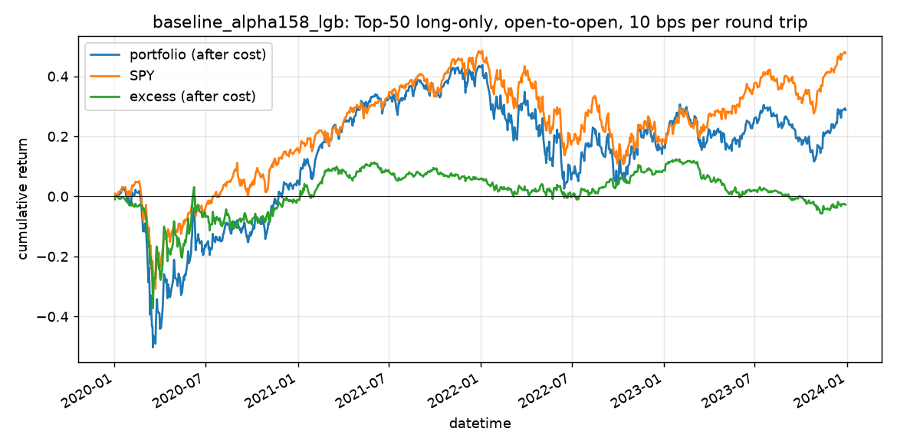

# baseline_alpha158_lgb（qrun 基线）

- recorder 085a90c7cd6b4f35919982d0429c8993，实验 baseline_alpha158_lgb；测试期 2020-01-02 至 2023-12-29，1006 个交易日
- 信号：IC 0.0066、ICIR 0.0549、Rank IC 0.0058、Rank ICIR 0.0539（日均截面相关，标签为开盘到开盘）

## 回测（TopkDropout 50/5，deal_price open，单边 5 bps，基准 SPY）

| 指标 | 值 |
| --- | ---: |
| excess_return_without_cost/mean | 0.0 |
| excess_return_without_cost/std | 0.0106 |
| excess_return_without_cost/annualized_return | 0.0042 |
| excess_return_without_cost/information_ratio | 0.0257 |
| excess_return_without_cost/max_drawdown | -0.3696 |
| excess_return_with_cost/mean | -0.0 |
| excess_return_with_cost/std | 0.0106 |
| excess_return_with_cost/annualized_return | -0.0065 |
| excess_return_with_cost/information_ratio | -0.0395 |
| excess_return_with_cost/max_drawdown | -0.3748 |

## 按年（收益为日收益简单求和）

| 年 | 组合 | SPY | 超额（扣费） | 日均换手 |
| --- | ---: | ---: | ---: | ---: |
| 2020 | 21.07% | 20.66% | -1.14% | 0.123 |
| 2021 | 32.89% | 24.80% | 7.08% | 0.081 |
| 2022 | -15.02% | -18.74% | 2.74% | 0.078 |
| 2023 | 12.16% | 22.61% | -11.42% | 0.077 |

