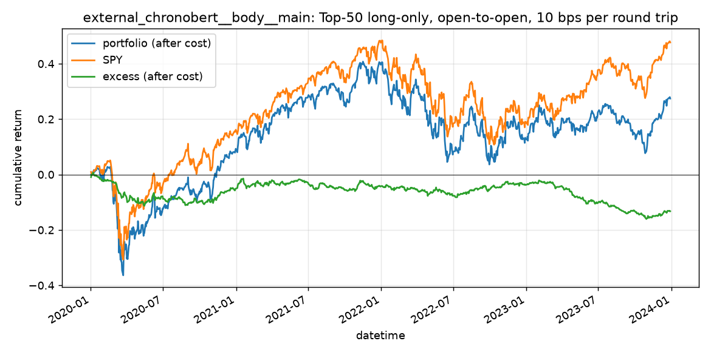

# external_chronobert__body__main（qrun 基线）

- recorder d7f80d36c4dd4a6790b6f7ad008c6c9f，实验 external_chronobert__body__main；测试期 2020-01-02 至 2023-12-29，1006 个交易日
- 信号：IC 0.006、ICIR 0.0446、Rank IC 0.0045、Rank ICIR 0.0344（日均截面相关，标签为开盘到开盘）

## 回测（TopkDropout 50/5，deal_price open，单边 5 bps，基准 SPY）

| 指标 | 值 |
| --- | ---: |
| excess_return_without_cost/mean | -0.0 |
| excess_return_without_cost/std | 0.0036 |
| excess_return_without_cost/annualized_return | -0.0095 |
| excess_return_without_cost/information_ratio | -0.173 |
| excess_return_without_cost/max_drawdown | -0.1215 |
| excess_return_with_cost/mean | -0.0001 |
| excess_return_with_cost/std | 0.0036 |
| excess_return_with_cost/annualized_return | -0.0313 |
| excess_return_with_cost/information_ratio | -0.5705 |
| excess_return_with_cost/max_drawdown | -0.1677 |

## 按年（收益为日收益简单求和）

| 年 | 组合 | SPY | 超额（扣费） | 日均换手 |
| --- | ---: | ---: | ---: | ---: |
| 2020 | 17.94% | 20.66% | -5.09% | 0.187 |
| 2021 | 27.89% | 24.80% | 0.87% | 0.177 |
| 2022 | -15.90% | -18.74% | 0.46% | 0.190 |
| 2023 | 15.38% | 22.61% | -9.48% | 0.180 |

