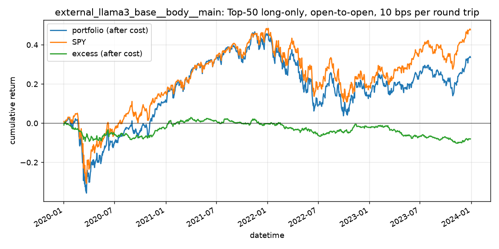

# external_llama3_base__body__main（qrun 基线）

- recorder e112ac7a9b1f4861ad66733eaeb280a1，实验 external_llama3_base__body__main；测试期 2020-01-02 至 2023-12-29，1006 个交易日
- 信号：IC 0.01、ICIR 0.0695、Rank IC 0.008、Rank ICIR 0.0563（日均截面相关，标签为开盘到开盘）

## 回测（TopkDropout 50/5，deal_price open，单边 5 bps，基准 SPY）

| 指标 | 值 |
| --- | ---: |
| excess_return_without_cost/mean | 0.0 |
| excess_return_without_cost/std | 0.0038 |
| excess_return_without_cost/annualized_return | 0.0024 |
| excess_return_without_cost/information_ratio | 0.0417 |
| excess_return_without_cost/max_drawdown | -0.095 |
| excess_return_with_cost/mean | -0.0001 |
| excess_return_with_cost/std | 0.0038 |
| excess_return_with_cost/annualized_return | -0.019 |
| excess_return_with_cost/information_ratio | -0.324 |
| excess_return_with_cost/max_drawdown | -0.1321 |

## 按年（收益为日收益简单求和）

| 年 | 组合 | SPY | 超额（扣费） | 日均换手 |
| --- | ---: | ---: | ---: | ---: |
| 2020 | 20.66% | 20.66% | -2.47% | 0.196 |
| 2021 | 29.31% | 24.80% | 2.17% | 0.186 |
| 2022 | -18.48% | -18.74% | -1.87% | 0.170 |
| 2023 | 18.87% | 22.61% | -5.85% | 0.169 |

