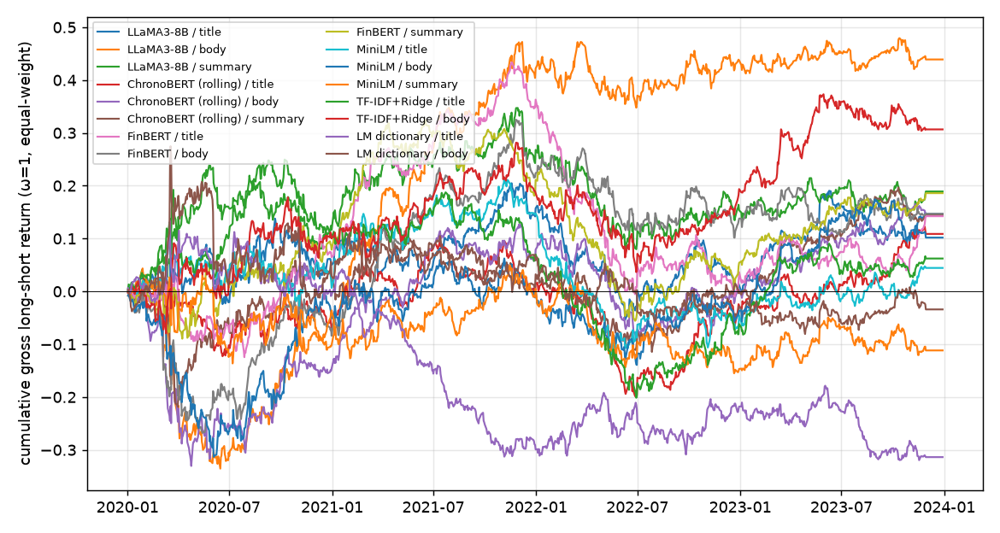

# 五分位多空（等权）：夏普、换手与成本

测试期 2020–2023，每日按 score 做多前 20%、做空后 20%（有新闻的股票中），t+1 开盘建仓、t+2 开盘换仓；不足 10 只的日子空仓。成本 = 费率 × Σ|Δw|（每 100% 交易额）。市值加权待历史市值（模块 1 任务 6）。

## 每日完全换仓（ω = 1）

| 模型 / 文本 | 年化收益 | 年化波动 | 夏普（毛） | 日均换手 Σ\|Δw\| | 净夏普 @5 bps | 净夏普 @10 bps | 净夏普 @20 bps | 有仓位天数 |
| --- | ---: | ---: | ---: | ---: | ---: | ---: | ---: | ---: |
| LLaMA3-8B / 标题 | +3.7% | 13.3% | +0.28 | 3.47 | -3.02 | -6.32 | -12.84 | 985/1006 |
| LLaMA3-8B / 原文 | +11.0% | 15.4% | +0.71 | 3.52 | -2.16 | -5.03 | -10.73 | 985/1006 |
| LLaMA3-8B / 摘要 | +4.7% | 14.6% | +0.32 | 3.48 | -2.68 | -5.69 | -11.65 | 985/1006 |
| ChronoBERT（按年滚动） / 标题 | +2.7% | 12.1% | +0.23 | 3.48 | -3.40 | -7.01 | -14.12 | 985/1006 |
| ChronoBERT（按年滚动） / 原文 | +3.6% | 14.3% | +0.25 | 3.54 | -2.86 | -5.96 | -12.09 | 985/1006 |
| ChronoBERT（按年滚动） / 摘要 | +3.6% | 14.0% | +0.26 | 3.58 | -2.97 | -6.18 | -12.53 | 985/1006 |
| FinBERT / 标题 | +3.6% | 12.9% | +0.28 | 3.54 | -3.18 | -6.63 | -13.45 | 985/1006 |
| FinBERT / 原文 | +3.7% | 14.5% | +0.25 | 3.55 | -2.83 | -5.90 | -11.99 | 985/1006 |
| FinBERT / 摘要 | +4.7% | 13.7% | +0.34 | 3.57 | -2.94 | -6.21 | -12.71 | 985/1006 |
| MiniLM / 标题 | +1.1% | 12.6% | +0.09 | 3.51 | -3.42 | -6.92 | -13.85 | 985/1006 |
| MiniLM / 原文 | +2.6% | 14.5% | +0.18 | 3.45 | -2.82 | -5.80 | -11.73 | 985/1006 |
| MiniLM / 摘要 | -2.8% | 14.9% | -0.19 | 3.46 | -3.11 | -6.02 | -11.79 | 985/1006 |
| TF-IDF + Ridge / 标题 | +1.6% | 12.5% | +0.12 | 3.57 | -3.47 | -7.04 | -14.11 | 985/1006 |
| TF-IDF + Ridge / 原文 | +7.7% | 15.0% | +0.51 | 3.57 | -2.48 | -5.47 | -11.38 | 985/1006 |
| LM 词典 / 标题 | -7.9% | 13.1% | -0.60 | 3.34 | -3.81 | -7.01 | -13.34 | 985/1006 |
| LM 词典 / 原文 | -0.9% | 16.8% | -0.05 | 3.51 | -2.69 | -5.33 | -10.58 | 985/1006 |

## EWCT 换手控制：ω 从 1（完全换仓）到 0.1；每格为 毛夏普 / 净夏普@10 bps（日均换手）

| 模型 / 文本 | ω=1.0 | ω=0.9 | ω=0.7 | ω=0.5 | ω=0.3 | ω=0.2 | ω=0.1 |
| --- | ---: | ---: | ---: | ---: | ---: | ---: | ---: |
| LLaMA3-8B / 标题 | +0.28 / -6.32 (3.47) | +0.22 / -6.12 (3.10) | +0.12 / -5.49 (2.37) | +0.05 / -4.50 (1.66) | +0.04 / -3.04 (0.96) | +0.06 / -2.11 (0.62) | +0.09 / -1.03 (0.29) |
| LLaMA3-8B / 原文 | +0.71 / -5.03 (3.52) | +0.73 / -4.77 (3.14) | +0.74 / -4.12 (2.40) | +0.66 / -3.34 (1.68) | +0.46 / -2.34 (0.97) | +0.31 / -1.69 (0.63) | +0.17 / -0.88 (0.30) |
| LLaMA3-8B / 摘要 | +0.32 / -5.69 (3.48) | +0.29 / -5.46 (3.10) | +0.20 / -4.84 (2.38) | +0.10 / -3.92 (1.66) | +0.05 / -2.61 (0.96) | +0.06 / -1.79 (0.62) | +0.06 / -0.88 (0.30) |
| ChronoBERT（按年滚动） / 标题 | +0.23 / -7.01 (3.48) | +0.25 / -6.72 (3.10) | +0.24 / -5.99 (2.37) | +0.17 / -4.99 (1.66) | +0.07 / -3.54 (0.96) | +0.06 / -2.55 (0.62) | +0.13 / -1.27 (0.29) |
| ChronoBERT（按年滚动） / 原文 | +0.25 / -5.96 (3.54) | +0.22 / -5.80 (3.16) | +0.12 / -5.30 (2.41) | -0.03 / -4.56 (1.68) | -0.18 / -3.50 (0.97) | -0.22 / -2.72 (0.63) | -0.13 / -1.53 (0.29) |
| ChronoBERT（按年滚动） / 摘要 | +0.26 / -6.18 (3.58) | +0.34 / -5.90 (3.19) | +0.48 / -5.16 (2.44) | +0.52 / -4.21 (1.70) | +0.43 / -2.96 (0.98) | +0.35 / -2.11 (0.63) | +0.37 / -0.96 (0.29) |
| FinBERT / 标题 | +0.28 / -6.63 (3.54) | +0.31 / -6.36 (3.16) | +0.36 / -5.64 (2.42) | +0.36 / -4.62 (1.69) | +0.29 / -3.22 (0.97) | +0.20 / -2.35 (0.63) | +0.02 / -1.34 (0.29) |
| FinBERT / 原文 | +0.25 / -5.90 (3.55) | +0.28 / -5.62 (3.17) | +0.27 / -4.91 (2.42) | +0.20 / -4.02 (1.69) | +0.08 / -2.84 (0.98) | +0.03 / -2.08 (0.63) | +0.05 / -1.10 (0.30) |
| FinBERT / 摘要 | +0.34 / -6.21 (3.57) | +0.34 / -6.02 (3.19) | +0.32 / -5.45 (2.44) | +0.27 / -4.58 (1.70) | +0.16 / -3.34 (0.98) | +0.07 / -2.51 (0.63) | -0.01 / -1.44 (0.29) |
| MiniLM / 标题 | +0.09 / -6.92 (3.51) | +0.11 / -6.63 (3.13) | +0.14 / -5.83 (2.40) | +0.16 / -4.70 (1.68) | +0.17 / -3.16 (0.97) | +0.14 / -2.23 (0.63) | +0.04 / -1.22 (0.30) |
| MiniLM / 原文 | +0.18 / -5.80 (3.45) | +0.18 / -5.53 (3.08) | +0.17 / -4.80 (2.36) | +0.16 / -3.80 (1.66) | +0.19 / -2.47 (0.97) | +0.23 / -1.63 (0.63) | +0.30 / -0.66 (0.30) |
| MiniLM / 摘要 | -0.19 / -6.02 (3.46) | -0.16 / -5.80 (3.08) | -0.12 / -5.19 (2.36) | -0.07 / -4.30 (1.66) | +0.01 / -2.99 (0.97) | +0.06 / -2.12 (0.63) | +0.06 / -1.11 (0.30) |
| TF-IDF + Ridge / 标题 | +0.12 / -7.04 (3.57) | +0.10 / -6.84 (3.18) | +0.04 / -6.20 (2.43) | -0.01 / -5.19 (1.70) | -0.06 / -3.68 (0.98) | -0.09 / -2.69 (0.63) | -0.09 / -1.46 (0.30) |
| TF-IDF + Ridge / 原文 | +0.51 / -5.47 (3.57) | +0.51 / -5.26 (3.18) | +0.49 / -4.66 (2.43) | +0.44 / -3.81 (1.70) | +0.43 / -2.58 (0.98) | +0.46 / -1.72 (0.63) | +0.49 / -0.68 (0.30) |
| LM 词典 / 标题 | -0.60 / -7.01 (3.34) | -0.57 / -6.73 (2.97) | -0.52 / -5.97 (2.26) | -0.50 / -4.90 (1.57) | -0.50 / -3.49 (0.91) | -0.51 / -2.66 (0.59) | -0.52 / -1.73 (0.28) |
| LM 词典 / 原文 | -0.05 / -5.33 (3.51) | -0.08 / -5.09 (3.13) | -0.16 / -4.47 (2.39) | -0.28 / -3.65 (1.66) | -0.41 / -2.62 (0.96) | -0.45 / -1.99 (0.62) | -0.44 / -1.26 (0.29) |

## 按年毛夏普（ω = 1）

| 模型 / 文本 | 2020 | 2021 | 2022 | 2023 |
| --- | ---: | ---: | ---: | ---: |
| LLaMA3-8B / 标题 | +0.28 | +0.91 | -1.12 | +1.62 |
| LLaMA3-8B / 原文 | -0.47 | +3.36 | +0.12 | +0.02 |
| LLaMA3-8B / 摘要 | +0.62 | +1.04 | -0.79 | +0.41 |
| ChronoBERT（按年滚动） / 标题 | -0.48 | +0.76 | -0.32 | +1.59 |
| ChronoBERT（按年滚动） / 原文 | -0.69 | +1.95 | -0.60 | +1.62 |
| ChronoBERT（按年滚动） / 摘要 | +0.12 | +0.07 | -0.48 | +2.23 |
| FinBERT / 标题 | +0.41 | +2.64 | -2.28 | +1.18 |
| FinBERT / 原文 | -0.42 | +2.24 | -0.64 | +0.10 |
| FinBERT / 摘要 | +0.41 | +1.11 | -1.20 | +1.65 |
| MiniLM / 标题 | +0.04 | +1.16 | -1.49 | +0.97 |
| MiniLM / 原文 | -0.25 | +0.38 | -0.31 | +1.39 |
| MiniLM / 摘要 | -0.17 | +0.31 | -1.15 | +0.37 |
| TF-IDF + Ridge / 标题 | +0.64 | -0.27 | -0.98 | +1.44 |
| TF-IDF + Ridge / 原文 | +0.48 | +0.66 | +0.06 | +1.04 |
| LM 词典 / 标题 | -0.03 | -2.81 | +0.66 | -1.12 |
| LM 词典 / 原文 | +0.10 | +0.25 | -0.50 | -0.38 |

