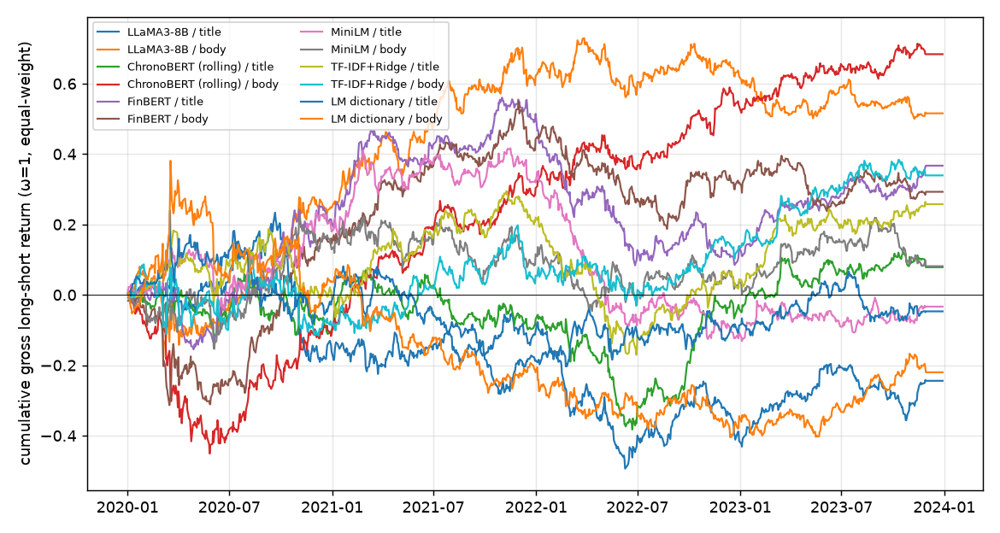

# 十分组多空（等权）：夏普、换手与成本

测试期 2020–2023，每日按 score 做多前 20%、做空后 20%（有新闻的股票中），t+1 开盘建仓、t+2 开盘换仓；不足 10 只的日子空仓。成本 = 费率 × Σ|Δw|（每 100% 交易额）。市值加权待历史市值（模块 1 任务 6）。

## 每日完全换仓（ω = 1）

| 模型 / 文本 | 年化收益 | 年化波动 | 夏普（毛） | 日均换手 Σ\|Δw\| | 净夏普 @5 bps | 净夏普 @10 bps | 净夏普 @20 bps | 有仓位天数 |
| --- | ---: | ---: | ---: | ---: | ---: | ---: | ---: | ---: |
| LLaMA3-8B / 标题 | -6.1% | 19.2% | -0.32 | 3.65 | -2.72 | -5.11 | -9.88 | 985/1006 |
| LLaMA3-8B / 原文 | +12.9% | 21.2% | +0.61 | 3.69 | -1.58 | -3.78 | -8.14 | 985/1006 |
| ChronoBERT（按年滚动） / 标题 | +2.0% | 18.1% | +0.11 | 3.66 | -2.44 | -4.98 | -10.02 | 985/1006 |
| ChronoBERT（按年滚动） / 原文 | +17.1% | 19.6% | +0.88 | 3.72 | -1.52 | -3.91 | -8.67 | 985/1006 |
| FinBERT / 标题 | +9.2% | 17.3% | +0.53 | 3.72 | -2.17 | -4.87 | -10.22 | 985/1006 |
| FinBERT / 原文 | +7.3% | 19.6% | +0.37 | 3.71 | -2.01 | -4.40 | -9.16 | 985/1006 |
| MiniLM / 标题 | -0.8% | 18.0% | -0.05 | 3.68 | -2.63 | -5.21 | -10.36 | 985/1006 |
| MiniLM / 原文 | +2.0% | 19.6% | +0.10 | 3.62 | -2.22 | -4.55 | -9.18 | 985/1006 |
| TF-IDF + Ridge / 标题 | +6.5% | 17.6% | +0.37 | 3.71 | -2.29 | -4.95 | -10.22 | 985/1006 |
| TF-IDF + Ridge / 原文 | +8.5% | 20.6% | +0.41 | 3.76 | -1.88 | -4.17 | -8.73 | 985/1006 |
| LM 词典 / 标题 | -1.2% | 19.0% | -0.06 | 3.69 | -2.51 | -4.96 | -9.82 | 985/1006 |
| LM 词典 / 原文 | -5.5% | 22.3% | -0.25 | 3.65 | -2.31 | -4.37 | -8.46 | 985/1006 |

## EWCT 换手控制：ω 从 1（完全换仓）到 0.1；每格为 毛夏普 / 净夏普@10 bps（日均换手）

| 模型 / 文本 | ω=1.0 | ω=0.9 | ω=0.7 | ω=0.5 | ω=0.3 | ω=0.2 | ω=0.1 |
| --- | ---: | ---: | ---: | ---: | ---: | ---: | ---: |
| LLaMA3-8B / 标题 | -0.32 / -5.11 (3.65) | -0.38 / -5.01 (3.27) | -0.46 / -4.61 (2.52) | -0.47 / -3.91 (1.78) | -0.36 / -2.80 (1.05) | -0.25 / -2.03 (0.68) | -0.09 / -1.06 (0.33) |
| LLaMA3-8B / 原文 | +0.61 / -3.78 (3.69) | +0.63 / -3.67 (3.31) | +0.61 / -3.33 (2.55) | +0.51 / -2.84 (1.80) | +0.31 / -2.11 (1.06) | +0.20 / -1.58 (0.69) | +0.14 / -0.83 (0.33) |
| ChronoBERT（按年滚动） / 标题 | +0.11 / -4.98 (3.66) | +0.10 / -4.87 (3.28) | +0.09 / -4.49 (2.53) | +0.10 / -3.85 (1.79) | +0.15 / -2.77 (1.05) | +0.22 / -1.98 (0.68) | +0.35 / -0.90 (0.33) |
| ChronoBERT（按年滚动） / 原文 | +0.88 / -3.91 (3.72) | +0.90 / -3.83 (3.33) | +0.85 / -3.55 (2.57) | +0.69 / -3.09 (1.82) | +0.45 / -2.37 (1.07) | +0.34 / -1.83 (0.70) | +0.28 / -1.01 (0.33) |
| FinBERT / 标题 | +0.53 / -4.87 (3.72) | +0.53 / -4.77 (3.33) | +0.53 / -4.38 (2.57) | +0.48 / -3.71 (1.82) | +0.31 / -2.73 (1.07) | +0.16 / -2.09 (0.69) | -0.04 / -1.29 (0.33) |
| FinBERT / 原文 | +0.37 / -4.40 (3.71) | +0.41 / -4.21 (3.33) | +0.38 / -3.78 (2.57) | +0.26 / -3.27 (1.82) | +0.08 / -2.53 (1.07) | +0.01 / -1.96 (0.70) | +0.03 / -1.08 (0.33) |
| MiniLM / 标题 | -0.05 / -5.21 (3.68) | -0.02 / -5.08 (3.30) | +0.02 / -4.62 (2.54) | +0.10 / -3.83 (1.80) | +0.19 / -2.64 (1.06) | +0.20 / -1.88 (0.69) | +0.13 / -1.01 (0.33) |
| MiniLM / 原文 | +0.10 / -4.55 (3.62) | +0.14 / -4.33 (3.24) | +0.18 / -3.78 (2.50) | +0.16 / -3.07 (1.78) | +0.12 / -2.11 (1.05) | +0.14 / -1.46 (0.69) | +0.20 / -0.64 (0.34) |
| TF-IDF + Ridge / 标题 | +0.37 / -4.95 (3.71) | +0.43 / -4.77 (3.33) | +0.49 / -4.27 (2.57) | +0.47 / -3.56 (1.81) | +0.34 / -2.57 (1.06) | +0.26 / -1.90 (0.69) | +0.27 / -0.94 (0.33) |
| TF-IDF + Ridge / 原文 | +0.41 / -4.17 (3.76) | +0.47 / -4.00 (3.37) | +0.53 / -3.54 (2.60) | +0.53 / -2.94 (1.83) | +0.54 / -2.04 (1.07) | +0.58 / -1.38 (0.70) | +0.63 / -0.50 (0.33) |
| LM 词典 / 标题 | -0.06 / -4.96 (3.69) | -0.09 / -4.84 (3.30) | -0.14 / -4.45 (2.53) | -0.21 / -3.79 (1.78) | -0.30 / -2.83 (1.03) | -0.37 / -2.22 (0.67) | -0.44 / -1.50 (0.32) |
| LM 词典 / 原文 | -0.25 / -4.37 (3.65) | -0.25 / -4.23 (3.27) | -0.22 / -3.80 (2.52) | -0.18 / -3.13 (1.78) | -0.18 / -2.20 (1.04) | -0.20 / -1.64 (0.68) | -0.23 / -1.01 (0.32) |

## 按年毛夏普（ω = 1）

| 模型 / 文本 | 2020 | 2021 | 2022 | 2023 |
| --- | ---: | ---: | ---: | ---: |
| LLaMA3-8B / 标题 | -0.63 | +0.34 | -1.66 | +1.40 |
| LLaMA3-8B / 原文 | +0.82 | +1.72 | -0.01 | -0.90 |
| ChronoBERT（按年滚动） / 标题 | -0.44 | +0.20 | +0.16 | +0.94 |
| ChronoBERT（按年滚动） / 原文 | -0.38 | +2.51 | +1.37 | +1.22 |
| FinBERT / 标题 | +0.99 | +1.91 | -1.97 | +1.99 |
| FinBERT / 原文 | +0.53 | +1.71 | -0.67 | -0.23 |
| MiniLM / 标题 | +0.80 | +0.78 | -2.43 | +0.58 |
| MiniLM / 原文 | +0.51 | -0.07 | -0.43 | +0.31 |
| TF-IDF + Ridge / 标题 | -0.04 | +1.42 | -0.94 | +1.88 |
| TF-IDF + Ridge / 原文 | -0.29 | +0.78 | +0.49 | +1.51 |
| LM 词典 / 标题 | -0.07 | -1.02 | +0.55 | +0.31 |
| LM 词典 / 原文 | +0.11 | -1.56 | -0.71 | +1.05 |

