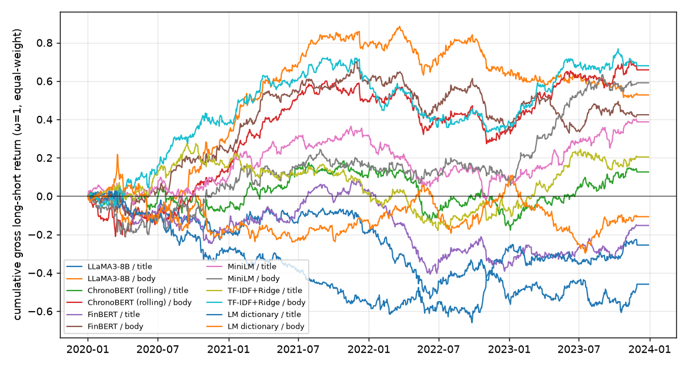

# 五分位多空（市值加权，缺市值的股票不入组合）：夏普、换手与成本

测试期 2020–2023，每日按 score 做多前 20%、做空后 20%（有新闻的股票中），t+1 开盘建仓、t+2 开盘换仓；不足 10 只的日子空仓。成本 = 费率 × Σ|Δw|（每 100% 交易额）。市值加权待历史市值（模块 1 任务 6）。

## 每日完全换仓（ω = 1）

| 模型 / 文本 | 年化收益 | 年化波动 | 夏普（毛） | 日均换手 Σ\|Δw\| | 净夏普 @5 bps | 净夏普 @10 bps | 净夏普 @20 bps | 有仓位天数 |
| --- | ---: | ---: | ---: | ---: | ---: | ---: | ---: | ---: |
| LLaMA3-8B / 标题 | -11.5% | 18.0% | -0.64 | 3.32 | -2.96 | -5.26 | -9.82 | 985/1006 |
| LLaMA3-8B / 原文 | +13.2% | 18.8% | +0.70 | 3.38 | -1.56 | -3.82 | -8.30 | 985/1006 |
| ChronoBERT（按年滚动） / 标题 | +3.2% | 16.4% | +0.19 | 3.31 | -2.35 | -4.88 | -9.89 | 985/1006 |
| ChronoBERT（按年滚动） / 原文 | +16.5% | 17.6% | +0.93 | 3.37 | -1.47 | -3.86 | -8.61 | 985/1006 |
| FinBERT / 标题 | -3.8% | 17.6% | -0.22 | 3.43 | -2.67 | -5.11 | -9.94 | 985/1006 |
| FinBERT / 原文 | +10.6% | 18.0% | +0.59 | 3.46 | -1.83 | -4.25 | -9.05 | 985/1006 |
| MiniLM / 标题 | +9.7% | 16.9% | +0.57 | 3.47 | -2.01 | -4.60 | -9.72 | 985/1006 |
| MiniLM / 原文 | +14.8% | 19.2% | +0.77 | 3.33 | -1.41 | -3.59 | -7.91 | 985/1006 |
| TF-IDF + Ridge / 标题 | +5.1% | 16.3% | +0.31 | 3.54 | -2.42 | -5.15 | -10.57 | 985/1006 |
| TF-IDF + Ridge / 原文 | +17.0% | 18.4% | +0.92 | 3.42 | -1.41 | -3.74 | -8.34 | 985/1006 |
| LM 词典 / 标题 | -6.4% | 17.8% | -0.36 | 3.16 | -2.59 | -4.82 | -9.20 | 985/1006 |
| LM 词典 / 原文 | -2.7% | 19.7% | -0.14 | 3.41 | -2.31 | -4.49 | -8.81 | 985/1006 |

## EWCT 换手控制：ω 从 1（完全换仓）到 0.1；每格为 毛夏普 / 净夏普@10 bps（日均换手）

| 模型 / 文本 | ω=1.0 | ω=0.9 | ω=0.7 | ω=0.5 | ω=0.3 | ω=0.2 | ω=0.1 |
| --- | ---: | ---: | ---: | ---: | ---: | ---: | ---: |
| LLaMA3-8B / 标题 | -0.64 / -5.26 (3.32) | -0.68 / -5.09 (2.95) | -0.72 / -4.54 (2.23) | -0.67 / -3.67 (1.55) | -0.51 / -2.45 (0.89) | -0.37 / -1.71 (0.58) | -0.22 / -0.90 (0.27) |
| LLaMA3-8B / 原文 | +0.70 / -3.82 (3.38) | +0.75 / -3.52 (3.00) | +0.81 / -2.87 (2.28) | +0.80 / -2.13 (1.58) | +0.66 / -1.32 (0.91) | +0.50 / -0.90 (0.59) | +0.25 / -0.48 (0.28) |
| ChronoBERT（按年滚动） / 标题 | +0.19 / -4.88 (3.31) | +0.22 / -4.61 (2.94) | +0.19 / -3.98 (2.23) | +0.09 / -3.19 (1.54) | +0.04 / -2.10 (0.89) | +0.09 / -1.37 (0.57) | +0.22 / -0.53 (0.27) |
| ChronoBERT（按年滚动） / 原文 | +0.93 / -3.86 (3.37) | +0.95 / -3.66 (2.99) | +0.89 / -3.15 (2.27) | +0.71 / -2.51 (1.57) | +0.45 / -1.70 (0.91) | +0.33 / -1.17 (0.58) | +0.24 / -0.53 (0.28) |
| FinBERT / 标题 | -0.22 / -5.11 (3.43) | -0.17 / -4.86 (3.05) | -0.10 / -4.24 (2.31) | -0.07 / -3.45 (1.61) | -0.07 / -2.41 (0.93) | -0.09 / -1.75 (0.60) | -0.16 / -1.03 (0.28) |
| FinBERT / 原文 | +0.59 / -4.25 (3.46) | +0.59 / -4.02 (3.07) | +0.52 / -3.48 (2.33) | +0.38 / -2.82 (1.62) | +0.15 / -2.02 (0.93) | +0.03 / -1.51 (0.60) | -0.07 / -0.88 (0.28) |
| MiniLM / 标题 | +0.57 / -4.60 (3.47) | +0.59 / -4.35 (3.08) | +0.61 / -3.68 (2.33) | +0.61 / -2.81 (1.62) | +0.56 / -1.76 (0.93) | +0.51 / -1.14 (0.60) | +0.43 / -0.46 (0.28) |
| MiniLM / 原文 | +0.77 / -3.59 (3.33) | +0.77 / -3.37 (2.96) | +0.71 / -2.83 (2.25) | +0.63 / -2.14 (1.57) | +0.58 / -1.25 (0.91) | +0.57 / -0.70 (0.59) | +0.57 / -0.09 (0.28) |
| TF-IDF + Ridge / 标题 | +0.31 / -5.15 (3.54) | +0.28 / -5.02 (3.15) | +0.18 / -4.57 (2.39) | +0.08 / -3.83 (1.65) | +0.04 / -2.69 (0.95) | +0.02 / -1.94 (0.61) | -0.00 / -1.04 (0.29) |
| TF-IDF + Ridge / 原文 | +0.92 / -3.74 (3.42) | +0.96 / -3.51 (3.04) | +0.98 / -2.94 (2.30) | +0.94 / -2.18 (1.60) | +0.87 / -1.20 (0.92) | +0.81 / -0.62 (0.59) | +0.68 / -0.05 (0.28) |
| LM 词典 / 标题 | -0.36 / -4.82 (3.16) | -0.36 / -4.67 (2.78) | -0.34 / -4.22 (2.08) | -0.33 / -3.57 (1.42) | -0.39 / -2.72 (0.81) | -0.47 / -2.21 (0.52) | -0.61 / -1.62 (0.25) |
| LM 词典 / 原文 | -0.14 / -4.49 (3.41) | -0.15 / -4.31 (3.03) | -0.14 / -3.77 (2.29) | -0.07 / -2.96 (1.58) | +0.04 / -1.89 (0.90) | +0.06 / -1.30 (0.58) | +0.02 / -0.70 (0.27) |

## 按年毛夏普（ω = 1）

| 模型 / 文本 | 2020 | 2021 | 2022 | 2023 |
| --- | ---: | ---: | ---: | ---: |
| LLaMA3-8B / 标题 | -1.03 | +0.10 | -1.78 | +0.43 |
| LLaMA3-8B / 原文 | +1.28 | +2.59 | -0.80 | -0.84 |
| ChronoBERT（按年滚动） / 标题 | -0.31 | +1.14 | -1.42 | +1.77 |
| ChronoBERT（按年滚动） / 原文 | +0.64 | +2.47 | -0.80 | +1.93 |
| FinBERT / 标题 | -0.85 | +1.45 | -2.03 | +1.28 |
| FinBERT / 原文 | +1.03 | +2.33 | -1.40 | +0.40 |
| MiniLM / 标题 | +0.55 | +1.49 | -1.14 | +1.74 |
| MiniLM / 原文 | +0.21 | +0.69 | -0.57 | +3.16 |
| TF-IDF + Ridge / 标题 | +0.88 | -0.97 | -0.40 | +1.65 |
| TF-IDF + Ridge / 原文 | +1.69 | +1.30 | -1.30 | +1.79 |
| LM 词典 / 标题 | -1.48 | -2.09 | +1.38 | +0.07 |
| LM 词典 / 原文 | -0.61 | +0.16 | +1.15 | -1.08 |

